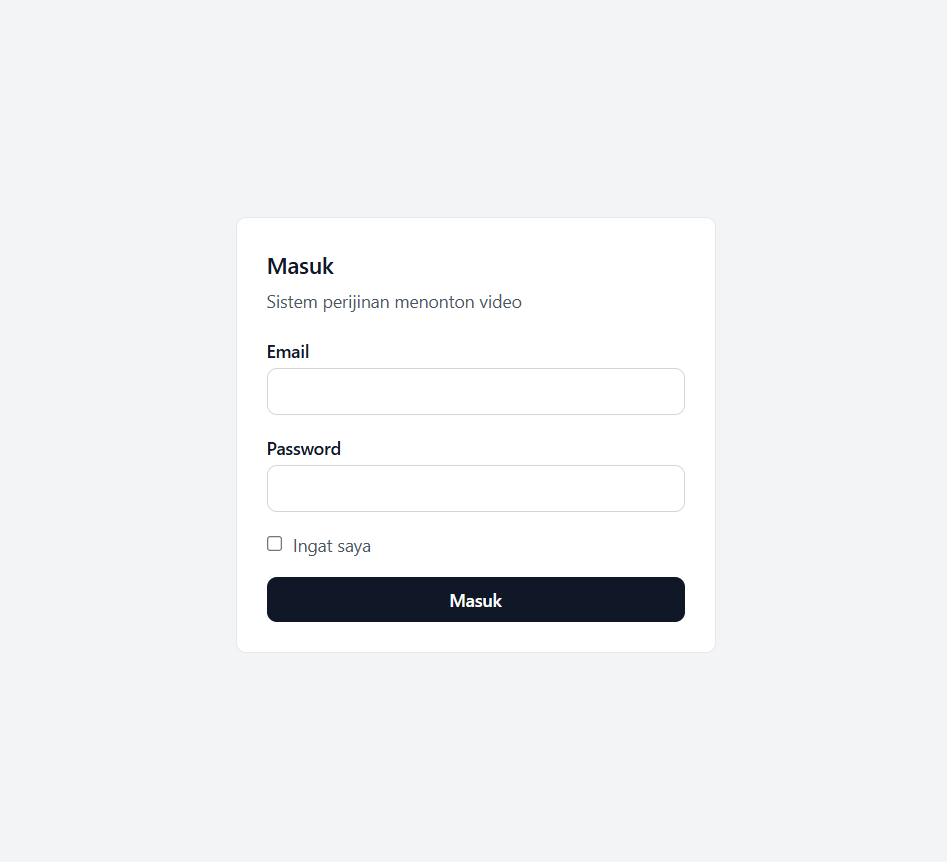
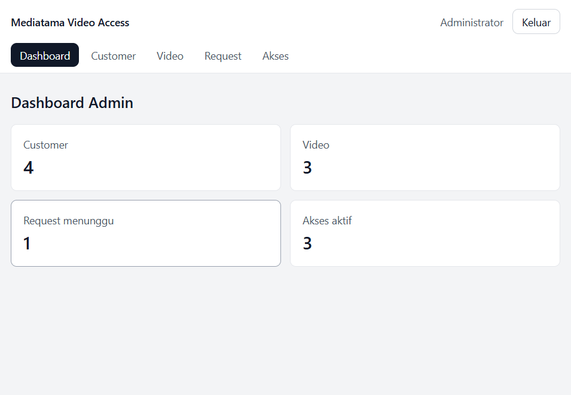
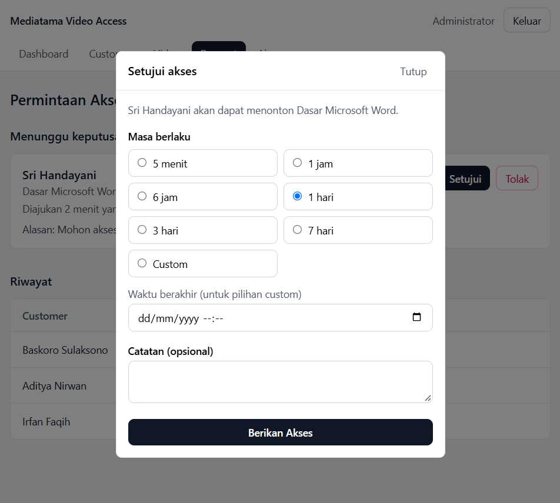
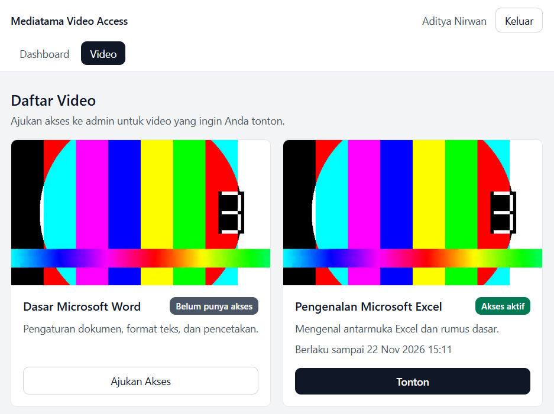
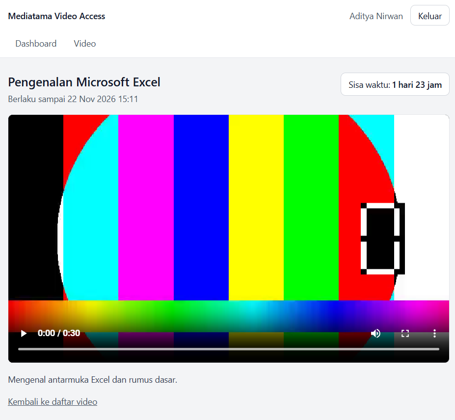
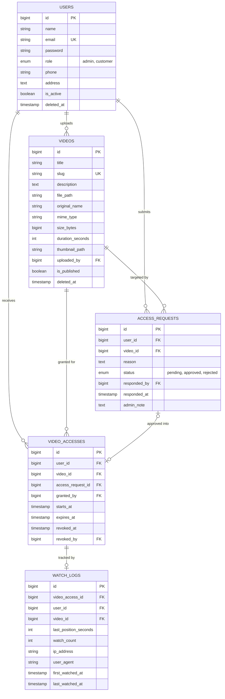

# Mediatama Video Access

Sistem perijinan menonton video: admin mengelola data customer dan video, lalu
memberi akses menonton dengan masa berlaku terbatas. 
Customer mengajukan akses, menonton selama masa berlaku, dan dapat mengajukan ulang setelah waktunya habis.

---

## Akun demo

Seluruh akun memakai password `password`.

| Peran | Email | Keterangan |
|---|---|---|
| Admin | `admin@mediatama.test` | Akses penuh ke seluruh panel admin |
| Customer | `adit@customer.test` | Punya dua akses aktif |
| Customer | `sri@customer.test` | Punya satu permintaan menunggu persetujuan dan satu akses yang habis dalam 10 menit |
| Customer | `irfan@customer.test` | Punya akses yang sudah kedaluwarsa, siap diajukan ulang |
| Customer | `baskoro@customer.test` | Punya permintaan yang ditolak beserta catatan admin |

Seeder sengaja membuat empat kondisi berbeda supaya seluruh siklus hidup akses
terlihat tanpa perlu membuatnya satu per satu.

> Jalankan `php artisan migrate:fresh --seed` tepat sebelum mencoba aplikasi.
> Masa berlaku pada data contoh dihitung relatif terhadap waktu seeding, dan
> akses 10 menit milik `sri` akan sudah lewat kalau seeding dilakukan jauh
> sebelumnya.

---

## Tampilan

| | |
|---|---|
|  |  |
|  |  |



---

## Fitur

**Admin**

- CRUD data customer, termasuk mengaktifkan dan menonaktifkan akun
- CRUD data video dengan unggah berkas, thumbnail, dan penyembunyian video dari customer
- Meninjau permintaan akses: menyetujui dengan masa berlaku, atau menolak dengan catatan
- Memberi akses langsung kepada customer tanpa menunggu permintaan
- Memperpanjang dan mencabut akses yang sedang berjalan
- Melihat riwayat menonton tiap akses: jumlah tontonan, waktu terakhir, posisi terakhir

**Customer**

- Melihat katalog video beserta status aksesnya masing-masing
- Mengajukan permintaan akses disertai alasan
- Menonton video yang sudah disetujui, dengan hitung mundur sisa waktu
- Melanjutkan tontonan dari posisi terakhir
- Mengajukan akses ulang setelah masa berlaku habis, ditolak, atau dicabut

---

## Teknologi

- Laravel 12 (PHP 8.2+)
- MySQL 8
- Blade, Tailwind CSS 4, Vite
- Autentikasi ditulis sendiri, tanpa starter kit

---

## Instalasi

### 1. Kebutuhan

- PHP 8.2 atau lebih baru
- Composer
- MySQL 8
- Node.js hanya diperlukan bila ingin membangun ulang aset; hasil build sudah
  disertakan di `public/build`

### 2. Naikkan batas unggah PHP

Aplikasi ini menerima berkas video sampai 64 MB. Pada `php.ini`, sesuaikan:

```ini
upload_max_filesize = 64M
post_max_size = 64M
max_execution_time = 300
memory_limit = 256M
```

Tanpa ini, unggahan video berukuran besar ditolak PHP sebelum sampai ke
aplikasi.

### 3. Pasang proyek

```bash
git clone https://github.com/USERNAME/mediatama-video-access.git
cd mediatama-video-access

composer install
cp .env.example .env
php artisan key:generate
```

### 4. Siapkan database

```bash
mysql -u root -e "CREATE DATABASE mediatama_video_access CHARACTER SET utf8mb4 COLLATE utf8mb4_unicode_ci;"
```

Sesuaikan kredensial pada `.env`:

```ini
DB_DATABASE=mediatama_video_access
DB_USERNAME=root
DB_PASSWORD=
```

Pastikan `APP_URL` sama persis dengan alamat yang dipakai di browser. Bila
dijalankan lewat `php artisan serve`, nilainya:

```ini
APP_URL=http://127.0.0.1:8000
```

Thumbnail tidak akan tampil bila nilai ini berbeda dari host yang diakses.

### 5. Isi data

Ada dua cara, keduanya menghasilkan data yang sama. Pilih salah satu.

**Migrasi dan seeder:**

```bash
php artisan migrate:fresh --seed
```

**Atau impor dump SQL:**

```bash
mysql -u root mediatama_video_access < database/sql/mediatama_video_access.sql
```

### 6. Tautkan storage

```bash
php artisan storage:link
```

Perintah ini membuat symlink dan membutuhkan hak administrator di Windows. Bila
gagal, buat junction lewat Command Prompt:

```cmd
mklink /J "C:\path\ke\proyek\public\storage" "C:\path\ke\proyek\storage\app\public"
```

Hanya thumbnail yang dilayani lewat tautan ini. Berkas video tidak pernah
berada di direktori publik.

### 7. Jalankan

```bash
php artisan serve
```

Buka `http://127.0.0.1:8000`.

Bila ingin membangun ulang aset:

```bash
npm install
npm run build
```

---

## Struktur database



Lima tabel domain, di luar tabel bawaan framework (`sessions`, `cache`, `jobs`,
`migrations`).

| Tabel | Peran |
|---|---|
| `users` | Admin dan customer dalam satu tabel, dibedakan kolom `role` |
| `videos` | Metadata video; berkasnya disimpan di luar direktori publik |
| `access_requests` | Permintaan customer beserta keputusan admin |
| `video_accesses` | Izin menonton beserta jendela waktunya |
| `watch_logs` | Rekaman menonton per izin, satu baris per akses |

### Mengapa permintaan dan izin dipisah

`access_requests` dan `video_accesses` sengaja berada di tabel berbeda:

1. Admin dapat memberi izin **tanpa** ada permintaan lebih dulu, sesuai
   ketentuan soal. Pada kasus itu `access_request_id` bernilai null.
2. Satu customer dapat mengajukan berkali-kali untuk video yang sama setelah
   masa berlakunya habis. Riwayat permintaan dan riwayat masa berlaku adalah dua
   hal berbeda dan keduanya perlu tersimpan.
3. Izin dapat dicabut di tengah jalan tanpa mengubah status permintaan yang
   sudah disetujui.

---

## Alur kerja

1. Admin membuat data customer dan mengunggah video.
2. Customer membuka katalog dan mengajukan akses ke video yang diinginkan.
3. Admin menyetujui dengan memilih masa berlaku (5 menit hingga 7 hari, atau
   waktu khusus), atau menolak disertai catatan.
4. Customer menonton selama masa berlaku, dengan hitung mundur sisa waktu di
   halaman pemutar.
5. Saat masa berlaku habis, pemutar berhenti dan customer dapat mengajukan
   akses ulang.

Status yang mungkin dialami pasangan customer dan video:

| Kondisi | Yang dilihat customer |
|---|---|
| Belum pernah mengajukan | Tombol **Ajukan Akses** |
| Permintaan menunggu | Tombol nonaktif, label menunggu persetujuan |
| Permintaan ditolak | Catatan admin, boleh mengajukan lagi |
| Izin aktif | Tombol **Tonton** beserta sisa waktu |
| Izin habis atau dicabut | Tombol **Ajukan Akses Ulang** |

---

## Catatan dan batasan

Beberapa hal sengaja tidak dikerjakan agar ruang lingkup tetap sesuai soal:

- **Durasi video diisi manual** oleh admin. Membacanya otomatis memerlukan
  ffmpeg atau pustaka serupa di sisi server.
- **Tidak ada transcoding maupun HLS/DASH.** Berkas dilayani apa adanya dalam
  format aslinya.
- **Unggahan tidak dipecah menjadi potongan.** Berkas di atas 64 MB memerlukan
  penyesuaian `php.ini` dan, untuk ukuran yang jauh lebih besar, mekanisme
  unggah bertahap.
- **Berkas video tidak ikut terhapus** saat video dihapus, karena penghapusan
  video bersifat soft delete dan datanya masih dapat dipulihkan. Pada
  penggunaan jangka panjang hal ini memerlukan perintah pembersihan terjadwal.
- **Email customer yang dihapus tidak dapat dipakai ulang.** Baris yang di-soft
  delete masih menempati indeks unique pada kolom email.
- **Thumbnail dilayani secara publik.** Gambar sampul tidak dianggap rahasia, dan
  melayaninya lewat PHP pada setiap pemuatan katalog akan membebani server tanpa
  manfaat yang sepadan.

---

## Struktur kode yang relevan

```
app/
  Enums/            UserRole, RequestStatus
  Http/
    Controllers/    Admin, Customer, dan controller streaming
    Middleware/     EnsureUserHasRole
    Requests/       Validasi formulir yang aturannya banyak
  Models/           User, Video, AccessRequest, VideoAccess, WatchLog
  Policies/         VideoPolicy, gerbang tunggal untuk menonton
  Services/         VideoAccessService, seluruh aturan pemberian izin
  Support/          AccessDuration, VideoAccessState
database/
  migrations/       Lima tabel domain
  seeders/          Data contoh dengan empat kondisi berbeda
  sql/              Dump database
resources/views/
  components/       badge, modal, duration-picker, layouts
  admin/            Panel admin
  customer/         Katalog customer
  videos/           Halaman pemutar
storage/app/private/videos/   Berkas video, di luar jangkauan publik
```

Seluruh aturan pemberian dan pencabutan izin berada di `VideoAccessService`,
dan aturan "sedang berlaku atau tidak" ditulis satu kali sebagai
`VideoAccess::scopeActive()` agar tidak tersebar di beberapa tempat.
